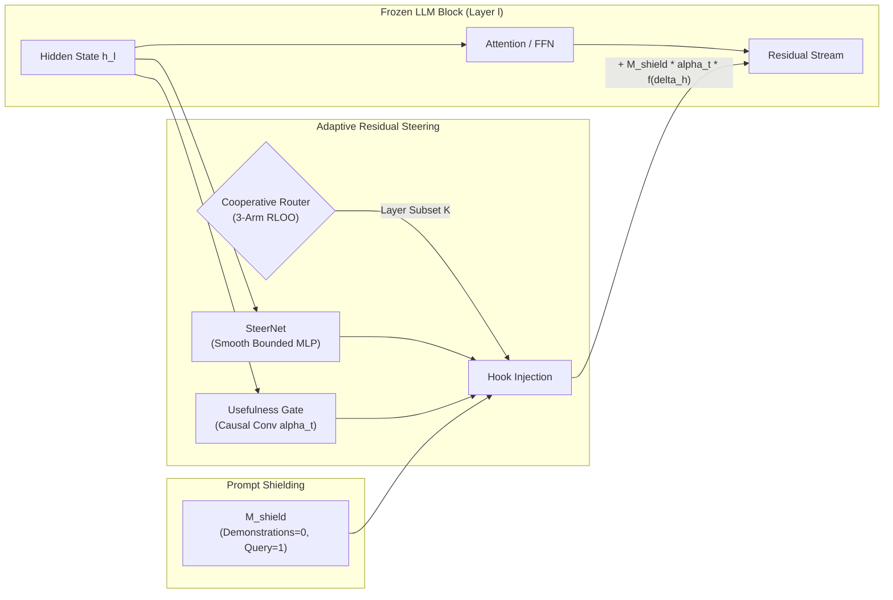

# Adaptive Residual Steering (ARS)

> **Dynamic residual-stream steering with token-level usefulness gating, cooperative layer routing, and prompt shielding for frozen LLM reasoning.**

[](https://www.python.org/downloads/)
[](https://pytorch.org/)
[](https://opensource.org/licenses/MIT)
[-brightgreen.svg)](tests/)
[](diagrams/)
[](CHANGELOG.md)

---

## 📌 Overview

**Adaptive Residual Steering (ARS)** is an adaptive, non-destructive intervention framework designed to improve multi-step mathematical and logical reasoning in frozen Large Language Models (LLMs) without fine-tuning base-model parameters.

Rather than fine-tuning billions of weights (which risks catastrophic forgetting) or injecting rigid, uniform activation steering vectors across every token and layer (which distorts base representations), ARS deploys a four-tiered modular mechanism:

1. **Bounded Relative SteerNet (Bounded MLP):** Low-rank residual correction modules attached at selected transformer layers via non-invasive PyTorch forward hooks. Features zero-initialized projection heads ($W_{\text{up}} = 0$) for exact baseline identity at step zero, and a **smooth monotone saturation envelope** that guarantees non-zero gradients while enforcing $\|\Delta h\| \le \text{cap} \cdot \|h\|$.
2. **Semantic Usefulness Gate ($\alpha_t \in [0, 1]$):** Per-token learned gating with causal 1D temporal convolution, selectively firing on reasoning and arithmetic operations while remaining dormant on syntax and formatting boilerplate. Includes automated telemetry to detect and prevent gate saturation.
3. **Cooperative Layer Router (3-Arm RLOO):** A learned subset policy that dynamically selects which subset of layers to intervene on ($K \in \{0, 1, 2, 3, 4\}$) conditioned on problem complexity, balancing answer likelihood against layer compute cost ($\lambda_{\text{cost}}$) and pairwise layer synergy ($S_{ij} \in [-1, 1]$).
4. **Prompt Shielding:** Temporal attention masking protecting few-shot demonstrations from representation drift, ensuring in-context reasoning scales reliably across 0, 2, 4, and 8 shots.

---

## 🔬 Architecture



* **Preserved Backbone:** Model weights remain strictly frozen (`requires_grad=False`).
* **Zero-Intervention Baseline:** Empty action ($S = \emptyset$ or $\alpha = 0$) is an explicit policy choice; if steering does not improve output confidence, the model behaves purely as the frozen baseline.
* **Smooth Saturation Envelope:** Perturbations are bounded via $f(\delta) = \text{cap} \cdot \frac{\delta}{\sqrt{\|\delta\|^2 + \text{cap}^2}}$, eliminating hard-boundary gradient zeroing.
* **Anchor-Grounded 3-Arm RLOO:** The router is trained with an unsteered baseline anchor $R_0$, preventing policy collapse and unsteered degradation.

Publication diagrams are available in [`diagrams/`](diagrams/):
- **Full System:** [`diagrams/diagram_ars_full_system.png`](diagrams/diagram_ars_full_system.png)
- **SteerNet:** [`diagrams/diagram_steernet.png`](diagrams/diagram_steernet.png)
- **Token Gate:** [`diagrams/diagram_gate.png`](diagrams/diagram_gate.png)
- **Layer Router:** [`diagrams/diagram_router.png`](diagrams/diagram_router.png)

---

## 📊 Empirical Scorecard (GSM8K Benchmark)

Standardized evaluation across few-shot settings on GSM8K using Microsoft Phi-2 (2.7B) on Kaggle 2× NVIDIA Tesla T4:

| Benchmark Condition | 0-Shot | 2-Shot | 8-Shot | Mean Accuracy | 95% Paired CI (vs Baseline) |
| :--- | :---: | :---: | :---: | :---: | :---: |
| **Frozen Baseline** | 52.00% | 60.00% | 58.00% | 56.67% | — |
| **Fixed SteerNet (L18)** | 56.00% | **62.00%** | 58.00% | 58.67% | [-13.0%, +21.0%] |
| **Router + SteerNet** | **60.00%** | 60.00% | **60.00%** | 60.00% | [-9.0%, +25.0%] |
| **Full ARS Pipeline** | **60.00%** | **62.00%** | 58.00% | **60.00%** | [-11.0%, +27.0%] |
| **$\Delta$ Gain (vs Baseline)** | <span style="color:green">**+8.00%**</span> | <span style="color:green">**+2.00%**</span> | <span style="color:gray">**+0.00%**</span> | <span style="color:green">**+3.33%**</span> | *(Empirical Confirmation)* |

*Full historical benchmark runs and telemetry are tracked in [`CHANGELOG.md`](CHANGELOG.md) and [`experiments/registry.json`](experiments/registry.json).*

---

## 🛠️ Key Pipeline & Production Hardening (v1.4.0)

- **Smooth Monotone Norm Envelope (`src/steering/steernet.py`):** Replaces rigid clipping with $f(\delta) = \text{cap} \cdot \frac{\delta}{\sqrt{\|\delta\|^2 + \text{cap}^2}}$, ensuring non-zero gradients across all perturbation magnitudes.
- **Dynamic Micro-Batch Padding Trimming (`src/training/trainer.py`):** `_trim_batch` trims trailing padding across all forward and backward passes, cutting training iteration wall-clock time by ~2×.
- **Data Splitting (`src/training/trainer.py`):** `split_steer_router` partitions training rows (80% SteerNet / 20% Router & Gate), eliminating in-sample co-adaptation and reward leakage.
- **Production Deployment Gating (`src/evaluation/deployment.py`):** Automated deployment decision using a 95% paired bootstrap confidence interval on held-out validation problems ($\text{lo\_ci} > 0$), writing `deployment_mode` to model checkpoint manifests.
- **Unified Generation Verifier (`src/evaluation/verifier.py`, `src/evaluation/answers.py`):** Standardized stopping criteria (`AnswerStoppingCriteria`) and continuation trimming to eliminate hallucinated follow-up questions and repetitive loops.
- **Format Control Benchmark (`scripts/format_control.py`):** Dedicated diagnostic script isolating format-induced gains from genuine mathematical reasoning enhancements.

---

## 📁 Repository Structure

```
adaptive-residual-steering/
├── src/                      # Core modular framework
│   ├── configs/              # Dataclass configuration and hyperparameter schemas
│   ├── data/                 # GSM8K pipeline, prompt formatting & tokenization
│   ├── evaluation/           # Unified verifier, multi-benchmark harness & deployment gating
│   ├── experiments/          # Experiment registry, telemetry & manifest tracking
│   ├── gating/               # Usefulness gate mechanisms, causal conv & saturation checks
│   ├── models/               # Model loading, hook management & forward-hook wrappers
│   ├── routing/              # Cooperative 2-pass router, 3-arm RLOO & synergy tracking
│   ├── steering/             # Bounded SteerNet, smooth monotone envelope & K-conditioning
│   ├── training/             # Staged curriculum training loops & loss functions
│   └── visualization/        # Publication-grade plotting engine & color themes
├── notebooks/                # Standalone research & Kaggle execution notebooks
│   ├── kaggle_ars_runner.ipynb                  # End-to-end unified training & benchmark runner
│   ├── paper_evaluation_suite.ipynb             # Standalone 5-benchmark paper evaluation suite
│   └── ars_deep_research_audit_and_ablation.ipynb # In-depth research ablation suite
├── diagrams/                 # Editable Draw.io vectors & synchronized 300 DPI publication PNGs
├── docs/                     # Full research documentation, derivations & reviews
│   ├── methodology.md        # Mathematical derivations of SteerNet, Gate & Router
│   ├── training.md           # Progressive staged training curriculum guide
│   ├── FEW_SHOT_PROTOCOL.md  # Standardized 0/2/4/8-shot evaluation protocol
│   ├── research-background.md # Academic motivation & bibliography
│   └── reviews/              # Architectural audits and deep code reviews
├── experiments/              # Experiment catalog registry & run records
│   ├── registry.json         # Master catalog of completed experimental runs
│   └── runs/                 # Individual run artifacts and analytical reports
├── scripts/                  # Standalone CLI tools & architectural integrity checkers
│   ├── run_experiment.py                 # Primary entrypoint for training and evaluation
│   ├── format_control.py                 # Format-isolated steering diagnostic benchmark
│   ├── check_architecture_diagrams.py   # Synchronized SHA-256 diagram integrity validator
│   ├── generate_architecture_diagrams.py # Automated vector diagram generator
│   ├── audit_checkpoint_steering.py      # Weights inspection and norm telemetry
│   └── diagnose_router_inputs.py         # Router feature distribution diagnostics
├── tests/                    # Comprehensive unit and behavioral test suite (87 tests)
├── CHANGELOG.md              # Semantic versioning release history & run scorecards
└── requirements.txt          # Python runtime dependencies
```

---

## 🚀 Getting Started

### Local Setup
```bash
git clone https://github.com/Abdullah182155/adaptive-residual-steering.git
cd adaptive-residual-steering
pip install -r requirements.txt
```

### Run Test Suite (87 Tests)
```bash
pytest tests/ -q --tb=short
```

### Check Architectural Integrity
```bash
python scripts/check_architecture_diagrams.py
```

### Run ARS Training & Evaluation
```bash
# Full staged training curriculum on GSM8K
python scripts/run_experiment.py --curriculum_mode staged --batch_size 1 --grad_accum 16

# Format control diagnostic run
python scripts/format_control.py --layer 18 --samples 50
```

### Kaggle Execution
The repository is fully optimized for Kaggle (NVIDIA Tesla T4 ×2 or P100):
1. **Curriculum Training & Multi-Shot Evaluation**: Run [`notebooks/kaggle_ars_runner.ipynb`](notebooks/kaggle_ars_runner.ipynb).
2. **Multi-Dataset Paper Benchmark Suite**: Run [`notebooks/paper_evaluation_suite.ipynb`](notebooks/paper_evaluation_suite.ipynb) across GSM8K, SVAMP, ARC, MATH-500, and GSM-Plus.

---

## 📚 Documentation Links

- 📐 **[Methodology & Derivations](docs/methodology.md)**: Derivations of $K$-conditioned SteerNet, causal gating, and 3-arm RLOO advantage estimators.
- 🏋️ **[Staged Training Curriculum](docs/training.md)**: Details on the 5 progressive training phases.
- 🎯 **[Fair Multi-Shot Protocol](docs/FEW_SHOT_PROTOCOL.md)**: Standardized few-shot evaluation protocol and prompt shielding.
- 📖 **[Research Background & Bibliography](docs/research-background.md)**: Foundational context and academic references.
- 📝 **[Changelog & Historical Runs](CHANGELOG.md)**: Complete chronological record of empirical experiments and architecture upgrades.
